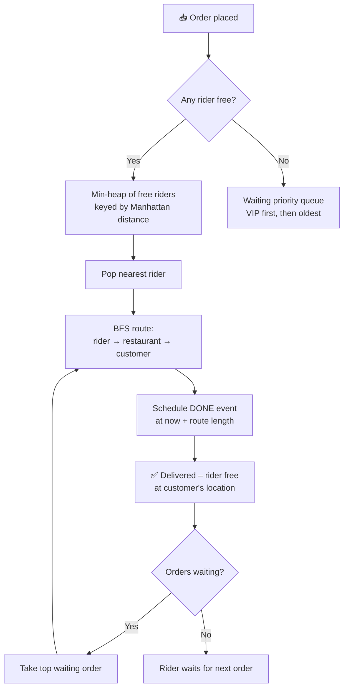
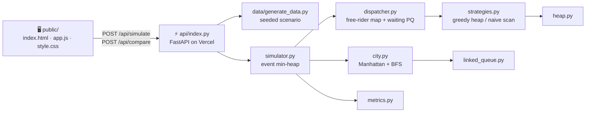

<div align="center">

# 🛵 QuickDrop

### Food delivery rider dispatcher, built from scratch in Python

Assigns every incoming order to the **nearest free rider**, routes them around the city with **BFS**,
and simulates a full day of deliveries – with every data structure hand-written.

[](https://quickdrop-dispatcher.vercel.app)


**[Live demo](https://quickdrop-dispatcher.vercel.app)** ·
**[API health](https://quickdrop-dispatcher.vercel.app/api/health)** ·
**[Project report](docs/REPORT.md)** ·
**[Viva notes](docs/VIVA_NOTES.md)**

</div>

---

## 📑 Table of contents

- [What it does](#-what-it-does)
- [Deployment links](#-deployment-links)
- [How the simulation works](#-how-the-simulation-works)
- [Data structures & complexity](#-data-structures--complexity)
- [Architecture](#-architecture)
- [Results](#-results)
- [Run it locally](#-run-it-locally)
- [API reference](#-api-reference)
- [Project structure](#-project-structure)
- [Deploy your own](#-deploy-your-own)
- [Future scope](#-future-scope)

---

## 🍔 What it does

QuickDrop is a mini **Swiggy / Zomato dispatcher** running on fast-forward.

| On the map | Meaning |
|---|---|
| 🟢 Green dot | Free rider waiting for an order |
| 🔴 Red dot + line | Busy rider and the route they will follow |
| 🟨 Yellow square | Restaurant |
| 🟣 Purple dot / ⭕ hollow circle | Customer – rider on the way / still waiting |
| ⬜ Grey blocks | Buildings – riders must go around them |

Press **Run simulation** and a full day (08:00 → midnight) plays out in about a minute, with
lunch and dinner rush hours, ~10% VIP orders, a live waiting-queue table and metric cards.
**Compare strategies** runs the same day twice to prove the heap-based dispatcher is faster.

## 🌐 Deployment links

| What | Link |
|---|---|
| 🚀 Live web app | https://quickdrop-dispatcher.vercel.app |
| ❤️ Health check | https://quickdrop-dispatcher.vercel.app/api/health |
| 📦 Source code | https://github.com/ankit848-ai/QuickDrop-dispatcher |

Hosted on **Vercel**: `public/` is served from the CDN and the FastAPI app in `api/index.py`
runs as a Python serverless function. Every push to `main` redeploys automatically.

## ⚙️ How the simulation works



1. **Event-driven clock** – events sit in a min-heap ordered by time; the simulator jumps straight to the next one.
2. **Nearest rider** – free riders go into a min-heap keyed by Manhattan distance to the restaurant; the top is the closest.
3. **Waiting queue** – if nobody is free, the order joins a priority queue: `(VIP first, older first)`.
4. **Routing** – BFS finds the shortest path around obstacles. One BFS tree per restaurant is cached, so each later route is just O(path length).
5. **Delivery done** – the rider is freed at the customer and immediately takes the highest-priority waiting order.

## 🧱 Data structures & complexity

> No `heapq`, no `queue` module, no `networkx` – everything in `quickdrop/` is implemented by hand.

| Structure | File | Used for | Complexity |
|---|---|---|---|
| Binary min-heap | `heap.py` | nearest free rider, event list | push / pop **O(log n)**, heapify **O(n)** |
| Priority queue | `heap.py` | waiting orders (VIP → oldest) | enqueue / dequeue **O(log n)** |
| Linked-list queue | `linked_queue.py` | BFS frontier | enqueue / dequeue **O(1)** |
| Hash map / set | `dispatcher.py`, `city.py` | riders, free riders, blocked cells, BFS cache | lookup **O(1)** avg |
| BFS | `city.py` | shortest obstacle-free route | **O(W × H)** per source, **O(L)** cached |

Whole simulation: **O(N log N + N·F + N·L + restaurants·W·H)**
(N orders, F free riders, L route length, W×H grid).

## 🏗️ Architecture



## 📊 Results

Greedy **nearest rider (heap)** vs naive **first free rider (scan)** – 50×50 city, seed 42, one simulated day:

| Riders / orders | Greedy avg delivery | Naive avg delivery | Improvement |
|---|---:|---:|---:|
| 50 / 100 | 47.4 min | 69.4 min | **−32%** |
| 200 / 100 | 39.8 min | 71.5 min | **−44%** |
| 200 / 1 000 | 51.8 min | 72.3 min | **−28%** |
| 50 / 1 000 | 365.2 min | 385.0 min | −5% |
| 10 / 1 000 *(overloaded)* | 3 125.8 min | 3 079.8 min | ≈ 0% |

<p align="center">
  
  
</p>

**Takeaways**

- ✅ With enough riders, picking the nearest one cuts delivery time by **~30–44%**.
- ⚠️ When the fleet is overloaded, both strategies converge – freed riders always take the top waiting order, so **capacity becomes the bottleneck**, not the algorithm.
- ⚡ A full 10 000-order day simulates in about **0.3 s**.

Full table and charts: [docs/REPORT.md](docs/REPORT.md) · raw data: [benchmarks/results/benchmark.csv](benchmarks/results/benchmark.csv)

## 💻 Run it locally

**Requirements:** Python 3.12+ (Windows commands shown).

```bash
git clone https://github.com/ankit848-ai/QuickDrop-dispatcher.git
cd QuickDrop-dispatcher
python -m venv .venv
.venv\Scripts\activate
pip install -r requirements-dev.txt
```

| Task | Command |
|---|---|
| Run the web app (http://localhost:8000) | `uvicorn api.index:app --reload --port 8000` |
| Run all tests | `python -m pytest -q` |
| Run benchmarks (CSV + charts) | `python benchmarks/benchmark.py` |
| Generate CSV data | `python -m data.generate_data --riders 50 --orders 1000 --seed 42` |

## 🔌 API reference

| Method | Path | Body | Returns |
|---|---|---|---|
| `GET` | `/api/health` | – | `{"status": "ok"}` |
| `POST` | `/api/simulate` | `{riders ≤ 200, orders ≤ 2000, city_size 10–80, strategy: "greedy" \| "naive", seed}` | map, restaurants, orders with routes, animation frames, metrics |
| `POST` | `/api/compare` | same | greedy vs naive metrics on identical inputs |

```bash
curl -X POST https://quickdrop-dispatcher.vercel.app/api/compare -H "Content-Type: application/json" -d "{\"riders\": 60, \"orders\": 500}"
```

## 📁 Project structure

```
quickdrop/
├── quickdrop/              🧠 core engine – pure Python, no dependencies
│   ├── heap.py             MinHeap + PriorityQueue
│   ├── linked_queue.py     linked-list Queue
│   ├── models.py           Order, Rider, Restaurant
│   ├── city.py             grid, obstacles, Manhattan, BFS
│   ├── dispatcher.py       assign_order(), complete_delivery()
│   ├── strategies.py       greedy heap vs naive linear
│   ├── simulator.py        event-driven simulation
│   └── metrics.py          delivery / wait / utilization / orders per hour
├── data/generate_data.py   🎲 seeded scenario generator → CSV
├── api/index.py            ⚡ FastAPI app (Vercel serverless)
├── public/                 🖥️ web UI (canvas map, Chart.js)
├── tests/                  🧪 44 pytest tests (unit + API)
├── benchmarks/             📊 benchmark.py + results/
└── docs/                   📄 REPORT.md, VIVA_NOTES.md
```

## 🚀 Deploy your own

```bash
npm i -g vercel
vercel login
vercel --prod
```

Vercel detects FastAPI in `api/index.py` automatically. `requirements.txt` contains only `fastapi`;
dev tools live in `requirements-dev.txt`.

## 🔭 Future scope

- Pick the waiting order nearest to a freed rider (with ageing so no order starves)
- Batch two orders from the same restaurant onto one rider
- Weighted roads and traffic → Dijkstra / A*
- k-d tree for faster nearest-rider search
- Real city maps from OpenStreetMap

---

<div align="center">

**Built by Ankit Dash** · Data Structures & Algorithms project


</div>
