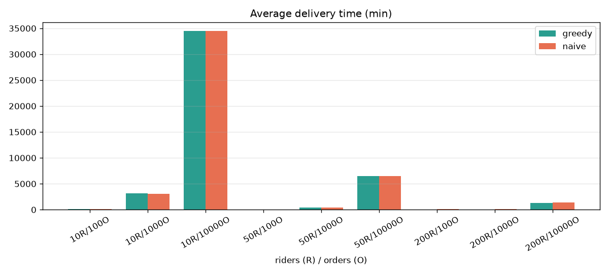
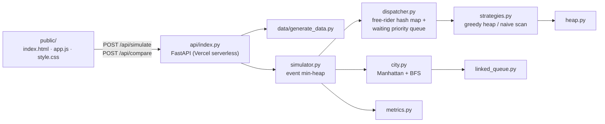

# QuickDrop – Food Delivery Rider Dispatcher

QuickDrop assigns incoming food orders to the nearest free rider on a city grid, routes riders around obstacles with BFS, and simulates a full day of deliveries. The algorithms run in a pure-Python engine where every data structure is hand-written: no `heapq`, no `queue`, no `networkx`. The results are shown in a live web app.

**Live demo:** https://quickdrop.vercel.app *(replace with your URL after `vercel --prod`)*



## Features

- **Nearest-rider dispatch** with a hand-written binary **min-heap** keyed by Manhattan distance
- **Waiting priority queue**: VIP orders first, then oldest first
- **BFS shortest paths** around blocked cells, using a hand-written **linked-list queue** and a per-restaurant BFS-tree cache
- **Event-driven simulation**: events ordered by timestamp in a min-heap
- **Strategy comparison**: greedy heap against naive first-free-rider, measured on delivery time, wait time, utilization, orders/hour and runtime
- **Web app**: animated canvas map, play/pause, speed and timeline controls, metric cards, a live waiting-queue table, a Chart.js comparison and a "How it works" section. It works on mobile.

## Architecture



```
quickdrop/
├── quickdrop/            core engine (pure Python, no external deps)
│   ├── heap.py           MinHeap + PriorityQueue
│   ├── linked_queue.py   linked-list Queue
│   ├── models.py         Order, Rider, Restaurant
│   ├── city.py           grid, obstacles, Manhattan, BFS
│   ├── dispatcher.py     assign_order(), complete_delivery()
│   ├── strategies.py     greedy heap vs naive linear
│   ├── simulator.py      event-driven simulation
│   └── metrics.py        delivery / wait / utilization / orders per hour
├── data/generate_data.py seeded scenario generator -> CSV
├── api/index.py          FastAPI app
├── public/               web UI
├── tests/                pytest (unit + API)
├── benchmarks/           benchmark.py + results/ (CSV, PNG)
└── docs/                 REPORT.md, VIVA_NOTES.md
```

## Data structures and complexity

| Structure | Used for | Complexity |
|---|---|---|
| Binary min-heap | nearest free rider, event queue | push/pop O(log n), heapify O(n) |
| Priority queue | waiting orders (VIP, then oldest) | enqueue/dequeue O(log n) |
| Linked-list queue | BFS frontier | enqueue/dequeue O(1) |
| Hash map / set | riders, free riders, blocked cells, BFS cache | O(1) average |
| BFS | shortest route on the grid | O(W × H) per source, O(path) once cached |

## Setup (Windows)

```bash
cd D:\PROJECTS\quickdrop
```
```bash
python -m venv .venv
```
```bash
.venv\Scripts\activate
```
```bash
pip install -r requirements-dev.txt
```

## Usage

Run the tests:
```bash
python -m pytest -q
```

Run the web app locally (API + UI on http://localhost:8000):
```bash
uvicorn api.index:app --reload --port 8000
```

Generate CSV data:
```bash
python -m data.generate_data --riders 50 --orders 1000 --seed 42
```

Run the benchmarks (writes `benchmarks/results/*.csv` and `*.png`):
```bash
python benchmarks/benchmark.py
```

### API

| Method | Path | Body | Returns |
|---|---|---|---|
| GET | `/api/health` | – | `{"status": "ok"}` |
| POST | `/api/simulate` | `{riders ≤ 200, orders ≤ 2000, city_size 10–80, strategy: "greedy"\|"naive", seed}` | grid and obstacles, restaurants, orders with routes, animation frames (rider positions/states, waiting queue), metrics |
| POST | `/api/compare` | same | greedy and naive metrics on identical inputs |

## Results

50 × 50 city, seed 42, one simulated day (full table in [docs/REPORT.md](docs/REPORT.md)):

| Riders / orders | Greedy avg delivery | Naive avg delivery | Improvement |
|---|---:|---:|---:|
| 50 / 100 | 47.4 min | 69.4 min | −32 % |
| 200 / 100 | 39.8 min | 71.5 min | −44 % |
| 200 / 1 000 | 51.8 min | 72.3 min | −28 % |
| 50 / 1 000 | 365.2 min | 385.0 min | −5 % |
| 10 / 1 000 (overloaded) | 3 125.8 min | 3 079.8 min | ≈ 0 % |

When enough riders are available, choosing the nearest one saves roughly a third of the delivery time. When the fleet is overloaded, freed riders always take the top waiting order, so both strategies behave the same and capacity becomes the bottleneck. A 10 000-order day simulates in about 0.3 s.

## Deploy to Vercel

1. Install the CLI:
   ```bash
   npm i -g vercel
   ```
2. Log in and deploy:
   ```bash
   vercel login
   ```
   ```bash
   vercel --prod
   ```

`vercel.json` serves `public/` as static files and routes `/api/*` to the FastAPI function in `api/index.py`. `requirements.txt` holds only `fastapi`, the runtime dependency.

To auto-deploy on every push, push the repo to GitHub and import it at https://vercel.com/new.

## Documentation

- [Project report](docs/REPORT.md)
- [Viva notes – 30 questions](docs/VIVA_NOTES.md)
- [Build progress](PROGRESS.md)

## Author

Ankit Dash
