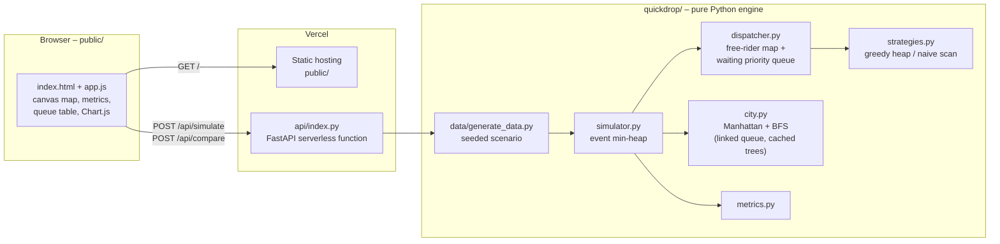
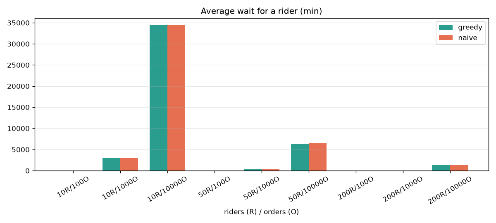
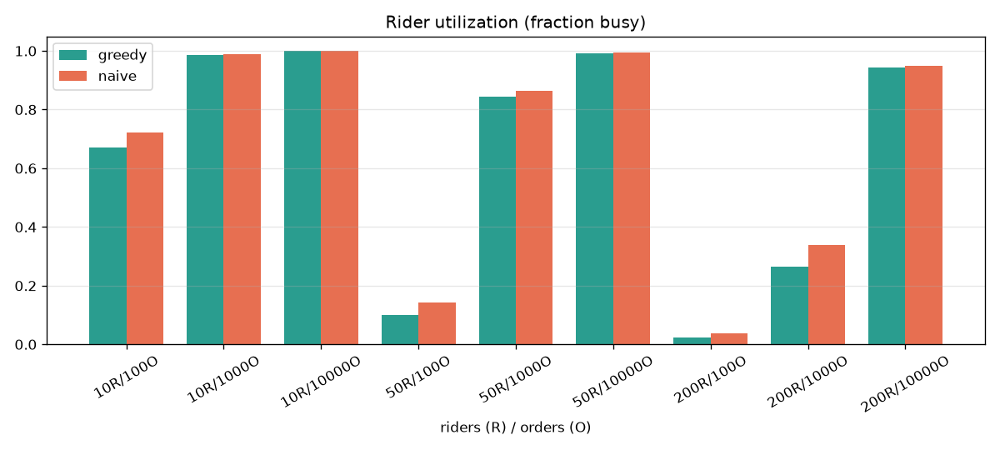
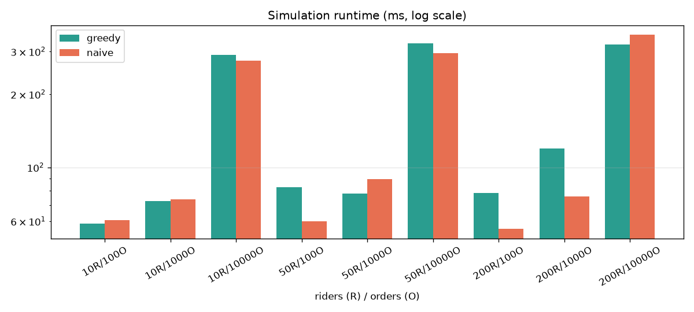

# QuickDrop: A Food Delivery Rider Dispatcher Built from Scratch

**Author:** Ankit Dash
**Course:** Data Structures and Algorithms – Project Report

---

## 1. Abstract

QuickDrop simulates a food delivery platform (in the style of Zomato or Swiggy) on a 2D city grid. Incoming orders are assigned to the nearest free rider using a hand-written binary min-heap; when no rider is free, orders wait in a priority queue that serves VIP customers first and then older orders. Riders follow shortest paths computed with breadth-first search around obstacles. An event-driven simulator processes a full day of orders using a timestamp-ordered min-heap. We compare the greedy nearest-rider strategy with a naive first-free-rider strategy. With enough riders, greedy cuts average delivery time by **28–44 %**. When the fleet is overloaded, both strategies converge, because the backlog, not rider choice, dominates. All core data structures are implemented without `heapq`, `queue` or graph libraries, and the system is deployed as a web app on Vercel.

## 2. Introduction

Food delivery companies must decide, every few seconds, which rider should take which order. A poor decision sends a rider across the city while another rider sits next to the restaurant. The decision has to be fast, fair to waiting customers, and aware of the real road network.

This project models that problem with classic data structures:

* **Min-heap** to find the nearest free rider and to order simulation events by time.
* **Priority queue** to hold waiting orders (VIP first, then oldest).
* **Linked-list queue** as the BFS frontier.
* **Hash maps and sets** for O(1) rider lookup, the free-rider pool, blocked cells and cached BFS trees.
* **Breadth-first search** for shortest routes on an unweighted grid.

## 3. Problem Statement

Given:

* a city grid of size W × H with some blocked cells;
* restaurants and riders at grid cells;
* a stream of orders, each with a restaurant, a customer cell, a creation time and a VIP flag;

assign each order to a rider and simulate the deliveries so that:

1. a new order goes to the **nearest free rider** (Manhattan distance to the restaurant);
2. if no rider is free, the order waits in a **priority queue** (VIP first, then oldest);
3. a rider who finishes becomes free **at the customer's location** and immediately takes the highest-priority waiting order;
4. travel follows the **shortest obstacle-avoiding path** (rider → restaurant → customer), one cell per minute.

We then measure average delivery time, average wait time, rider utilization, orders per hour and runtime, and compare against a naive strategy.

## 4. Data Structures Used

| Structure | File | Purpose | Operations and complexity |
|---|---|---|---|
| Binary min-heap (array based) | `quickdrop/heap.py` | Nearest free rider; event list | push O(log n), pop O(log n), peek O(1), heapify O(n) |
| Priority queue (wraps min-heap) | `quickdrop/heap.py` | Waiting orders | enqueue O(log n), dequeue O(log n), snapshot O(n log n) |
| Singly linked FIFO queue | `quickdrop/linked_queue.py` | BFS frontier | enqueue O(1), dequeue O(1) |
| Hash map (`dict`) | `dispatcher.py`, `simulator.py`, `city.py` | riders by id, free riders, orders by id, BFS cache | get / set / delete O(1) average |
| Hash set (`set`) | `city.py` | blocked cells | membership O(1) average |
| Dataclasses | `quickdrop/models.py` | `Order`, `Rider`, `Restaurant` | O(1) field access |

**Heap layout.** The heap is a Python list. For index *i*, the parent is at (i − 1) // 2 and the children are at 2i + 1 and 2i + 2. Each slot stores `(key, counter, item)`. The counter is a running insertion number, so ties on the key come out first-in-first-out and the items themselves never need to be comparable.

**Waiting priority.** Key = `(0 if VIP else 1, created_at, id)`. Tuples compare left to right, so every VIP order comes before every normal order, and within a class the oldest order comes first.

## 5. Algorithms and Complexity

Notation: N orders, R riders, F free riders at a moment, W waiting orders, L route length, V = W × H cells.

### 5.1 Manhattan distance
`|x1 − x2| + |y1 − y2|`. O(1). It is used to rank riders cheaply. On a grid it is a lower bound on the real route length.

### 5.2 Breadth-first search
Unweighted grid → BFS gives shortest paths. Each cell is enqueued at most once and has at most 4 neighbours, so time and space are O(V).

*Optimisation (BFS-tree cache).* Instead of running BFS per trip, we run one full BFS from each restaurant and cache its distance and parent maps in a dictionary. The grid is undirected, so the same tree gives both legs of a trip: restaurant → rider (reversed) and restaurant → customer. Each route then costs O(L) after a one-time O(V) per restaurant.

*Connectivity.* After obstacles are placed, one BFS from the centre finds the reachable region and all other free cells are blocked. Every trip is therefore guaranteed to have a route.

### 5.3 Rider selection strategies

| Strategy | How | Time per order | Space |
|---|---|---|---|
| **Greedy (heap)** | heapify free riders keyed by Manhattan distance, pop the minimum | O(F) heapify + O(log F) pop = O(F) | O(F) |
| **Naive (linear)** | scan riders in id order, take the first free one | O(R) | O(1) |

Both are linear per decision. The heap's advantage is in the *quality* of the choice, not asymptotic speed. A heap would also give the *k* nearest riders in O(F + k log F), which is useful for batching or offering an order to several riders.

### 5.4 Dispatcher
* `assign_order(order, now)`: run the strategy; if a rider is found mark them busy (O(1) hash-map updates), otherwise enqueue the order (O(log W)).
* `complete_delivery(rider, order, now)`: move the rider to the customer, mark them free; if orders are waiting, dequeue the top one and assign it to this rider (O(log W)).

### 5.5 Event-driven simulation
All ORDER events are heapified at the start (O(N)). The loop pops the earliest event, handles it, and may push a DONE event at `now + trip length`. Events at the same minute are ordered `(time, kind)` with DONE before ORDER, so riders freed at minute *t* are available to orders placed at minute *t*.

Total: **O(N log N + N·F + N·L + restaurants·V)** time, O(N + R + restaurants·V) space.

### 5.6 Metrics
* Delivery time = delivered − created; wait time = assigned − created.
* Utilization = Σ rider busy minutes ÷ (R × span), where span runs from the first order to the last delivery.
* Orders per hour = delivered ÷ (span / 60).
* P90 delivery time uses the nearest-rank percentile.

## 6. System Design

**Request flow.** The browser posts `{riders, orders, city_size, strategy, seed}`. The API generates a deterministic scenario, runs the simulator with animation frames enabled (≤ 300 frames), and returns the obstacle list, restaurants, every order with its route (as flat cell indices `y·size + x`), the frames (rider positions and states, plus the top of the waiting queue) and the metrics. The browser animates the frames on an HTML canvas.

## 7. Implementation

* **Language:** Python 3.12, pure standard library in `quickdrop/` (`random`, `dataclasses`, `typing`, `time`).
* **Style:** every class and method has a docstring with time and space complexity; type hints throughout.
* **Data generation:** `data/generate_data.py` uses a seeded `random.Random`. Order times are 40 % around lunch (12:30, σ = 45 min), 45 % around dinner (20:30, σ = 60 min) and 15 % uniform between 08:00 and 23:59. About 10 % are VIP. Restaurants default to `size² / 150` (16 on a 50 × 50 map). Obstacles are small 1–3 cell rectangles covering about 12 % of the city.
* **API:** FastAPI with Pydantic validation; inputs are capped at 200 riders, 2000 orders and an 80 × 80 city so each request finishes well within Vercel's 10-second limit.
* **Frontend:** vanilla JavaScript. Static layers (streets, buildings, restaurants) are drawn once to an off-screen canvas; each frame only draws customers, routes and riders. There is a play/pause button, a timeline scrubber and a speed slider. The comparison chart uses Chart.js from a CDN.
* **Testing:** pytest. There are unit tests per module and API tests with FastAPI's `TestClient`.

## 8. Results

Benchmarks: `python benchmarks/benchmark.py`. 50 × 50 city, seed 42, one simulated day. Each configuration ran both strategies on identical inputs. Raw data is in `benchmarks/results/benchmark.csv`.

| Riders | Orders | Strategy | Avg delivery (min) | Avg wait (min) | Utilization | Runtime (ms) |
|---:|---:|---|---:|---:|---:|---:|
| 10 | 100 | greedy | **103.9** | **37.6** | 0.669 | 58.7 |
| 10 | 100 | naive | 126.2 | 52.9 | 0.722 | 60.7 |
| 10 | 1 000 | greedy | 3 125.8 | 3 054.0 | 0.987 | 72.7 |
| 10 | 1 000 | naive | 3 079.8 | 3 008.8 | 0.988 | 73.9 |
| 10 | 10 000 | greedy | 34 470.7 | 34 400.9 | 1.000 | 290.7 |
| 10 | 10 000 | naive | 34 456.4 | 34 386.6 | 0.999 | 275.4 |
| 50 | 100 | greedy | **47.4** | 0.0 | 0.100 | 82.7 |
| 50 | 100 | naive | 69.4 | 0.0 | 0.142 | 60.1 |
| 50 | 1 000 | greedy | **365.2** | **295.1** | 0.845 | 78.1 |
| 50 | 1 000 | naive | 385.0 | 312.8 | 0.864 | 89.6 |
| 50 | 10 000 | greedy | 6 475.4 | 6 405.9 | 0.993 | 324.1 |
| 50 | 10 000 | naive | 6 508.7 | 6 439.0 | 0.994 | 294.3 |
| 200 | 100 | greedy | **39.8** | 0.0 | 0.022 | 78.6 |
| 200 | 100 | naive | 71.5 | 0.0 | 0.038 | 55.7 |
| 200 | 1 000 | greedy | **51.8** | **0.0** | 0.264 | 119.5 |
| 200 | 1 000 | naive | 72.3 | 1.1 | 0.340 | 76.0 |
| 200 | 10 000 | greedy | 1 327.8 | 1 259.0 | 0.943 | 320.9 |
| 200 | 10 000 | naive | 1 346.5 | 1 276.8 | 0.950 | 350.8 |

### 8.1 Discussion

1. **Enough riders → greedy is clearly better.** With 50 riders / 100 orders, greedy delivers in 47.4 min against 69.4 min (−32 %). With 200 riders / 100 orders the figures are 39.8 against 71.5 (−44 %), and with 200 / 1 000 they are 51.8 against 72.3 (−28 %). Nearby riders mean shorter first legs.
2. **Overloaded fleet → strategies converge.** At 10 riders with 1 000+ orders, or 50 riders with 10 000 orders, orders wait hours. Most assignments then happen in `complete_delivery`, where the rule is "the freed rider takes the top waiting order". That rule does not depend on the strategy, so both strategies behave almost the same. Delivery time is dominated by queueing, and the fix is more riders, not a smarter choice. (With 10 riders / 1 000 orders, greedy is even 1.5 % worse. This is within the noise of which rider frees up first.)
3. **Higher utilization is not always better.** Naive shows *higher* utilization because its riders spend longer travelling for the same number of deliveries. Utilization should always be read together with delivery time.
4. **Runtime.** Both strategies are O(F) or O(R) per decision, so their runtimes are similar. A full 10 000-order day simulates in about 0.3 s. A large part of each short run is the one-time BFS tree for each of the 16 restaurants (16 × 2 500 cells).
5. **VIP fairness.** The single-rider unit test confirms that a later VIP order is served before an earlier normal order. On the web app the waiting queue table shows VIP orders at the top during the dinner rush.

## 9. Deployment

* Vercel detects the FastAPI app in `api/index.py` and routes every non-static request (`/api/*`) to it. `vercel.json` sets `public/` as the static output directory, includes the `quickdrop/` and `data/` packages in the function bundle, and sets `maxDuration` to 10 s.
* `requirements.txt` contains only the runtime dependency (`fastapi`). Test, benchmark and dev tools are in `requirements-dev.txt`.
* `api/index.py` adds the project root to `sys.path` so `quickdrop` and `data` import the same way locally and on Vercel.
* Locally, `uvicorn api.index:app` serves both the API and the `public/` folder. On Vercel the static files are served by the CDN.

## 10. Conclusion

QuickDrop shows how textbook data structures solve a real logistics problem. A min-heap picks the nearest rider and drives the event clock. A priority queue encodes the business rule "VIP first, then oldest". A linked queue powers BFS, and hash maps keep every lookup constant-time. When riders are available, the greedy nearest-rider strategy cuts delivery times by roughly a third compared with picking any free rider. Under overload, the benchmarks show that capacity, not the assignment algorithm, is the bottleneck.

## 11. Future Scope

* **Smarter backlog handling:** when a rider frees up, choose the waiting order whose restaurant is nearest (with an ageing term so no order starves), instead of always taking the top of the queue.
* **Batching:** let a rider carry two orders from the same restaurant.
* **Weighted roads:** traffic and road types → Dijkstra or A* with Manhattan as the heuristic.
* **Spatial index:** a k-d tree or grid buckets so nearest-rider search does not touch every free rider.
* **Restaurant preparation time** and rider shifts or breaks.
* **Real maps** using OpenStreetMap data instead of a synthetic grid.

## 12. References

1. T. H. Cormen, C. E. Leiserson, R. L. Rivest, C. Stein. *Introduction to Algorithms*, 4th ed., MIT Press, 2022. Chapters on heapsort / priority queues and elementary graph algorithms (BFS).
2. R. W. Floyd. "Algorithm 245: Treesort 3." *Communications of the ACM*, 7(12), 1964. Bottom-up heap construction.
3. R. Sedgewick, K. Wayne. *Algorithms*, 4th ed., Addison-Wesley, 2011. Priority queues and graph search.
4. A. M. Law. *Simulation Modeling and Analysis*, 5th ed., McGraw-Hill, 2015. Discrete-event simulation.
5. FastAPI documentation – https://fastapi.tiangolo.com
6. Vercel Python runtime documentation – https://vercel.com/docs/functions/runtimes/python
